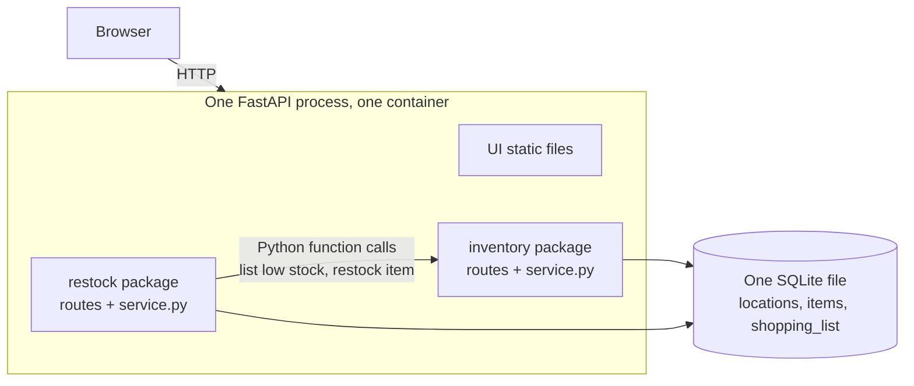
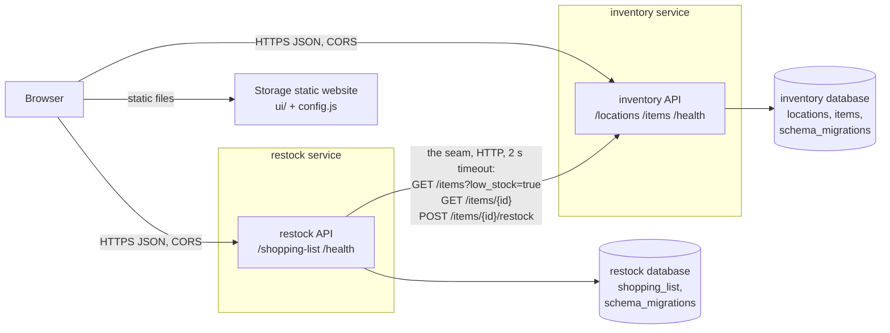
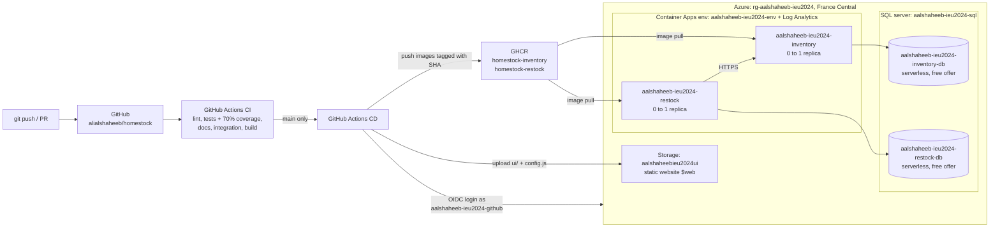
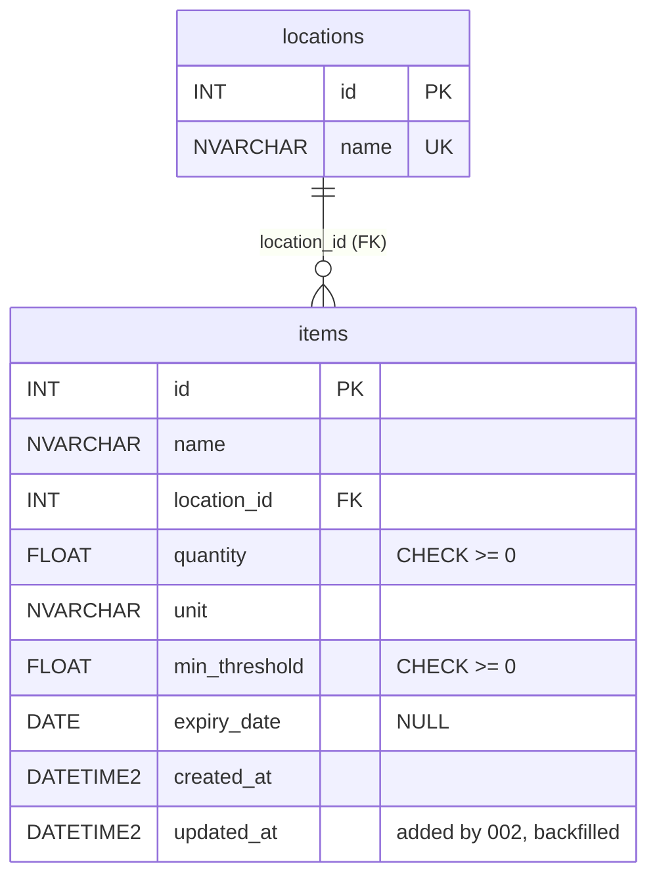
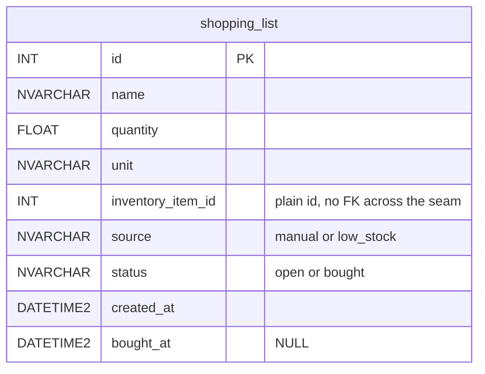

# Architecture

## Before: the Assignment 1 monolith

## After: two services, one database each

Restock never reads Inventory's database; `shopping_list.inventory_item_id` is a plain number.
If Inventory is down, Restock answers 503 for the three calls above and keeps serving its list.

## Deployment

## Databases (after migration 002)

A filtered unique index on `shopping_list (inventory_item_id) WHERE status = 'open'` allows
only one open entry per Inventory item. Each database also has `schema_migrations`.
